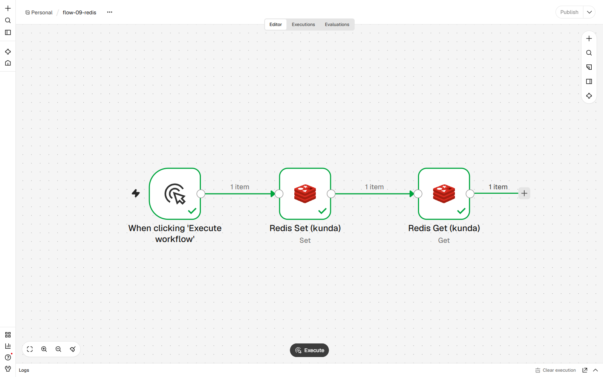
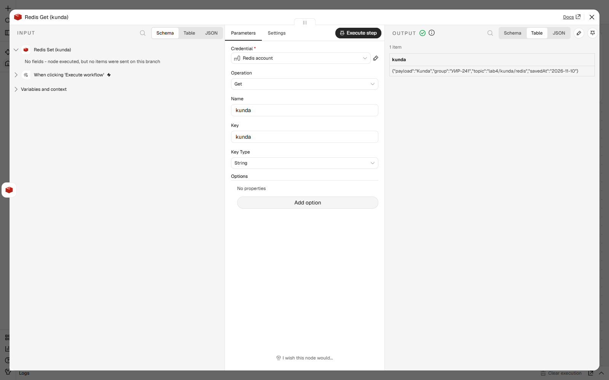
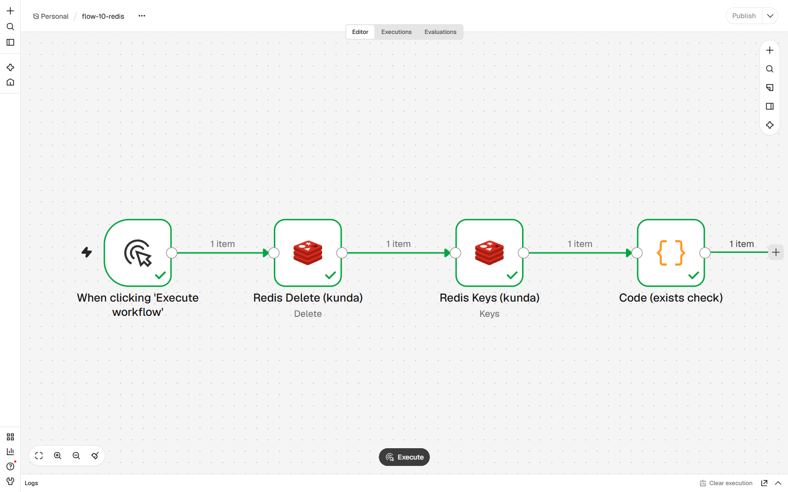
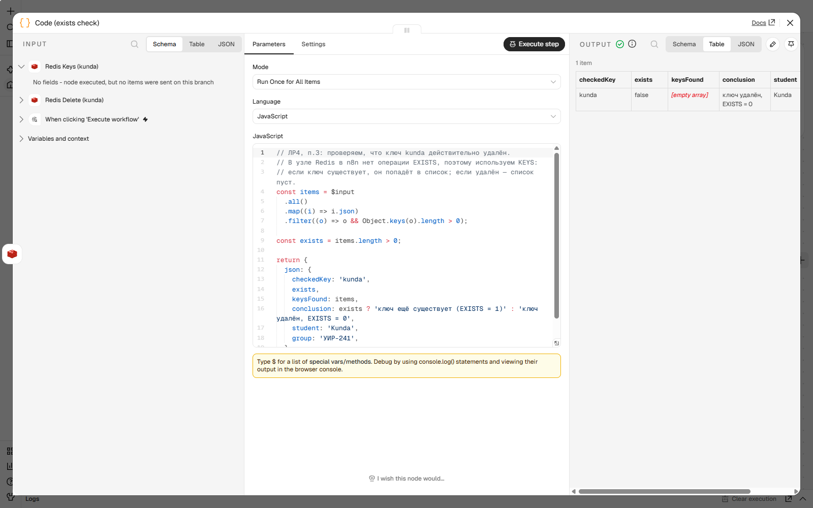

# Работа с Redis в n8n (лабораторная №4, п.3)

## 1. Запуск Redis

По методичке Redis поднимается в Docker:

```bash
docker run -d --name redis -p 6379:6379 redis:7
```

На машине, где выполнялась работа, Docker отсутствует (нет прав администратора
и WSL2), поэтому использована портативная сборка Redis для Windows
(`redis-server.exe`, версия 5.0.14.1), запущенная на том же порту:

```powershell
.\redis-server.exe --port 6379 --save 900 1
```

Проверка доступности:

```powershell
redis-cli -p 6379 ping
# PONG
```

С точки зрения n8n разницы нет: это тот же протокол Redis на порту 6379.

> В `docker-compose.yml` репозитория Redis описан как сервис `redis` с образом
> `redis:7` и портом `6379:6379` — эквивалентная конфигурация.

## 2. Credential в n8n

`Settings → Credentials → Create credential → Redis`.

| Поле | Значение |
|------|----------|
| Name | `Redis account` |
| Host | `127.0.0.1` (в Docker-варианте — `host.docker.internal`) |
| Port | `6379` |
| Database Number | `0` |
| Password / User | пусто (сервер без аутентификации) |

n8n сам проверяет соединение при сохранении — в форме появилось сообщение
`Connection tested successfully`.

Учётные данные в экспортированном JSON хранятся только ссылкой:

```json
"credentials": { "redis": { "id": "s7Axq0vEn30su9RL", "name": "Redis account" } }
```

Сам пароль в JSON не попадает.

## 3. Workflow 1: запись и чтение (`flow-09-redis`)

```
Manual Trigger → Redis (Set) → Redis (Get)
```

* **Redis Set**
  * Key: `kunda`
  * Value Type: JSON
  * Value:
    ```json
    {"payload":"Kunda","group":"УИР-241","topic":"lab4/kunda/redis","savedAt":"2026-11-10"}
    ```
* **Redis Get**
  * Key: `kunda`
  * Name (propertyName): `kunda`

Результат выполнения (узел `Redis Get`):

| Поле | Значение |
|------|----------|
| `kunda` | `{"payload":"Kunda","group":"УИР-241","topic":"lab4/kunda/redis","savedAt":"2026-11-10"}` |





## 4. Workflow 2: удаление и проверка (`flow-10-redis`)

```
Manual Trigger → Redis (Delete) → Redis (Keys) → Code
```

* **Redis Delete** — Key: `kunda`
* **Redis Keys** — Pattern: `kunda`
* **Code** — вычисляет признак существования ключа

### Почему не `EXISTS`

В узле `Redis` в n8n 2.47.3 операции `EXISTS` нет. Доступны:
`Delete, Get, Increment, Info, Keys, Publish, Set, Push, Pop, LLEN`.

Поэтому проверка существования сделана через `KEYS`:

* если ключ существует — он попадает в список;
* если ключ удалён — список пуст.

Код узла `Code`:

```js
const items = $input
  .all()
  .map((i) => i.json)
  .filter((o) => o && Object.keys(o).length > 0);

const exists = items.length > 0;

return {
  json: {
    checkedKey: 'kunda',
    exists,
    keysFound: items,
    conclusion: exists ? 'ключ ещё существует (EXISTS = 1)' : 'ключ удалён, EXISTS = 0',
    student: 'Kunda',
    group: 'УИР-241',
  },
};
```

Результат:

| `checkedKey` | `exists` | `keysFound` | `conclusion` |
|--------------|----------|-------------|--------------|
| `kunda` | `false` | `[]` | ключ удалён, EXISTS = 0 |





## 5. Проверка со стороны Redis

Независимая проверка через `redis-cli` (реальный вывод на этой машине):

```powershell
# после flow-09 (ключ записан)
redis-cli -p 6379 get kunda
# {"payload":"Kunda","group":"УИР-241","topic":"lab4/kunda/redis","savedAt":"2026-11-10"}

redis-cli -p 6379 exists kunda
# (integer) 1

# после flow-10 (ключ удалён)
redis-cli -p 6379 exists kunda
# (integer) 0

redis-cli -p 6379 keys *
# (empty array)

redis-cli -p 6379 get kunda
# (nil)
```

То есть результат узла `Code` (`exists = false`) подтверждается напрямую
средствами Redis.

## 6. Итог

| Операция | Узел n8n | Результат |
|----------|----------|-----------|
| Запись | Redis → Set | ключ `kunda` создан |
| Чтение | Redis → Get | значение прочитано и совпало с записанным |
| Удаление | Redis → Delete | ключ удалён |
| Проверка | Redis → Keys + Code | `exists = false` |

Ключ назван по фамилии (`kunda`), значения содержат фамилию и группу, что
делает данные уникальными в общем экземпляре Redis.
