# Лабораторная работа №4. Автоматизация в n8n: базовые узлы и Redis

**Выполнил:** Кунда Иван
**Группа:** УИР-241
**Дата:** 10.11.2026
**Репозиторий:** `visual-programming-labs-kunda`

---

## 1. Цель работы

Освоить построение сценариев автоматизации в n8n: ручные и временные
триггеры, узлы преобразования данных (`Set`, `Code`, `NoOp`), ветвление (`IF`),
HTTP-запросы к внешнему API и работу с внешним хранилищем Redis (запись,
чтение, удаление, проверка существования ключа).

## 2. Окружение

| Компонент | Версия / параметр |
|-----------|-------------------|
| ОС | Windows 11 (x64) |
| Node.js | v24.22.1 |
| n8n | **2.47.3** (Community Edition) |
| Redis | 5.0.14.1 (портативная сборка для Windows) |
| Браузер автоматизации | Chromium 158 (Playwright 1.65.0) |
| Git | 2.52.0 |

Адрес экземпляра n8n: <http://localhost:5678>, владелец зарегистрирован
локально (`kunda_iv_24@mf.grsu.by`).

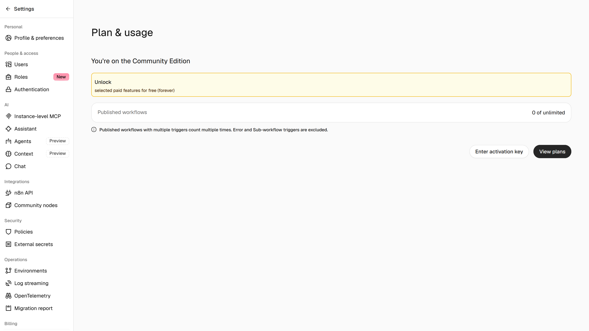

Список созданных воркфлоу:

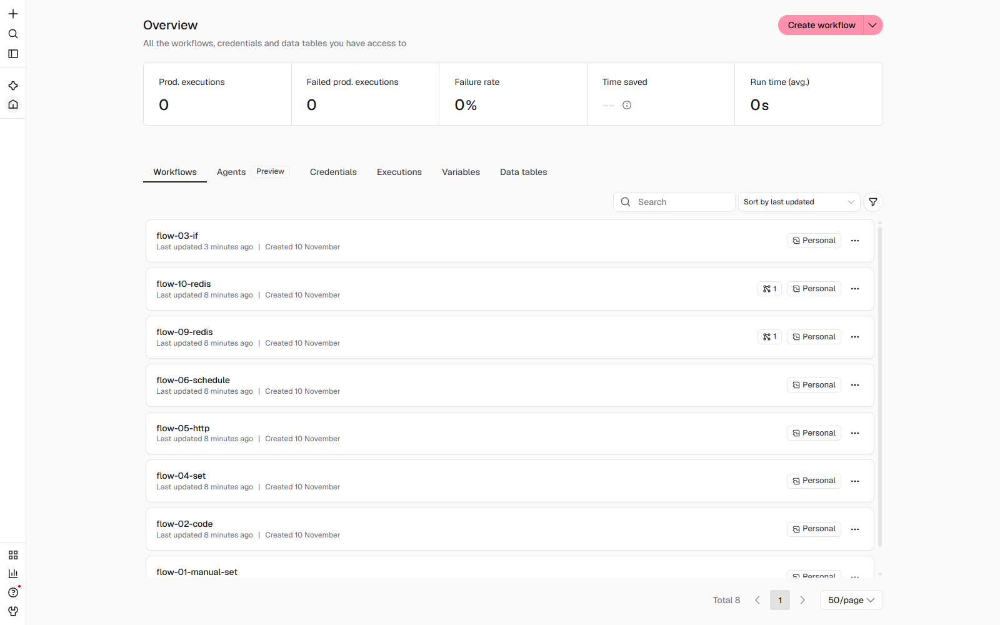

## 3. Отклонение от методички: запуск без Docker

Методичка предполагает запуск n8n и Redis в Docker. На машине, где
выполнялась работа, Docker **не установлен**, а его установка требует прав
администратора, включения WSL2 и перезагрузки системы. Чтобы не блокировать
выполнение, оба сервиса запущены нативно, с сохранением всех существенных
параметров конфигурации.

| Параметр | Docker (методичка) | Фактически |
|----------|--------------------|------------|
| n8n | образ `n8nio/n8n`, порт 5678 | `npm install n8n` → `n8n start`, порт 5678 |
| Данные n8n | volume `./n8n_data:/home/node/.n8n` | `%LOCALAPPDATA%\Temp\opencode\n8n-data` |
| Файлы n8n | volume `./n8n_data_files:/data` | тот же каталог данных |
| Redis | образ `redis:7`, порт 6379 | `redis-server.exe` 5.0.14.1, порт 6379 |
| Хост Redis из n8n | `host.docker.internal` | `127.0.0.1` |

Команды методички (сохранены в [`docker-compose.yml`](../../docker-compose.yml)):

```bash
docker run -d --name n8n \
  -p 5678:5678 \
  -v n8n_data:/home/node/.n8n \
  -v n8n_data_files:/data \
  -e N8N_SECURE_COOKIE=false \
  n8nio/n8n

docker run -d --name redis -p 6379:6379 redis:7
```

Фактический запуск (скрипты [`scripts/start-n8n.ps1`](../../scripts/start-n8n.ps1)
и [`scripts/start-redis.ps1`](../../scripts/start-redis.ps1)):

```powershell
# n8n
node node_modules\n8n\bin\n8n start     # N8N_USER_FOLDER указывает вне OneDrive

# Redis
.\redis-server.exe --port 6379 --save 900 1
```

Каталог данных n8n намеренно вынесен за пределы синхронизируемой папки
OneDrive: активная SQLite-база внутри OneDrive может быть повреждена
синхронизацией.

## 4. Выполнение работы

### 4.0. Как создавались воркфлоу

Воркфлоу описаны в JSON и импортированы в n8n штатной командой
`n8n import:workflow`, после чего **каждый запускался в интерфейсе n8n**
кнопкой «Execute workflow». Скриншоты сняты автоматически (Playwright) с
реального работающего экземпляра, JSON выгружены из n8n. Поэтому файлы в
`lab4/flows/` — это ровно те сценарии, которые исполнялись, а не рисунки «для
отчёта».

Для каждого пункта ниже приведены два скриншота: общий вид канваса после
успешного выполнения и панель узла с фактическими входными/выходными данными.

### 4.1. Manual Trigger → Set → Code

`flow-01-manual-set.json`

* **Set payload**: `payload = "Kunda"`, `topic = "lab4/kunda/basic"`.
* **Code**: читает данные из Set, пишет их в лог и возвращает объект с полями
  `payload`, `topic`, `student`, `group`, `processed`.

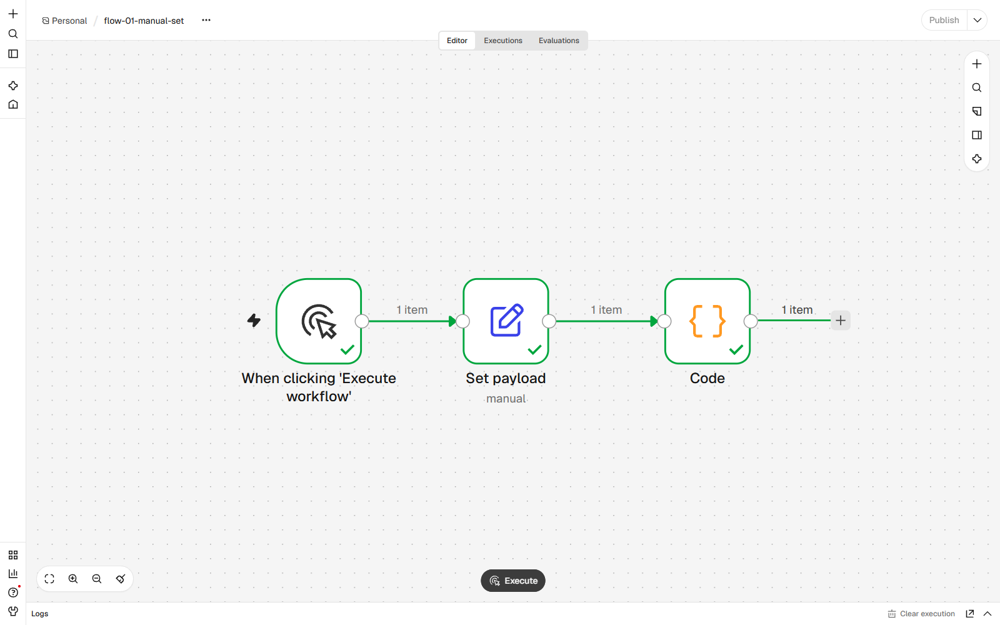

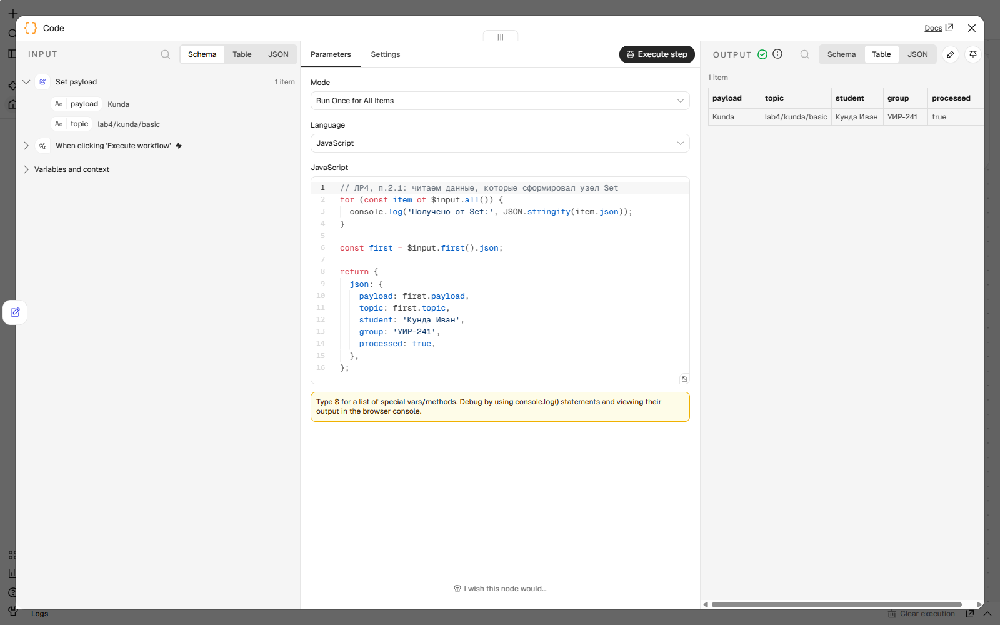

Результат: `payload = Kunda`, `topic = lab4/kunda/basic`, `group = УИР-241`,
`processed = true`.

### 4.2. Manual Trigger → Code → NoOp

`flow-02-code.json`

В узле `Code` использованы: `const`/`let`, массив, объект, цикл `for`,
конструкция `if/else`, `console.log`. Возвращается объект с полем `payload`.

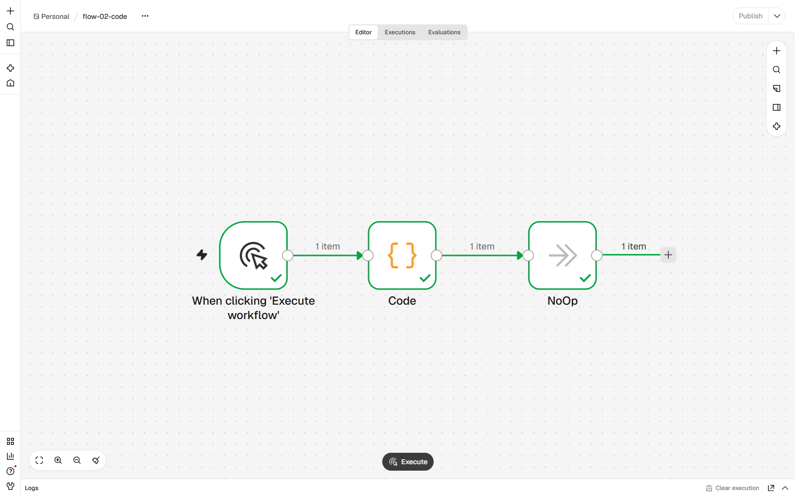

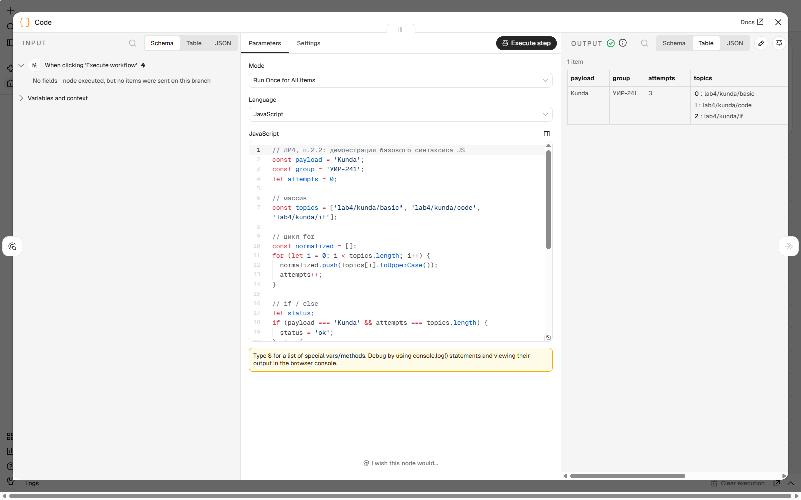

Результат: `payload = Kunda`, `attempts = 3`, `status = ok`,
`normalized = [LAB4/KUNDA/BASIC, LAB4/KUNDA/CODE, LAB4/KUNDA/IF]`.

### 4.3. Manual Trigger → Code → IF → (true) NoOp / (false) NoOp

`flow-03-if.json`

Условие в `IF`: `{{ $json.payload }}` **is equal to** `Kunda`.
Выполнение пошло по ветке **true** (1 item), ветка **false** пуста — это
видно на скриншоте по зелёной линии и серой ветке.

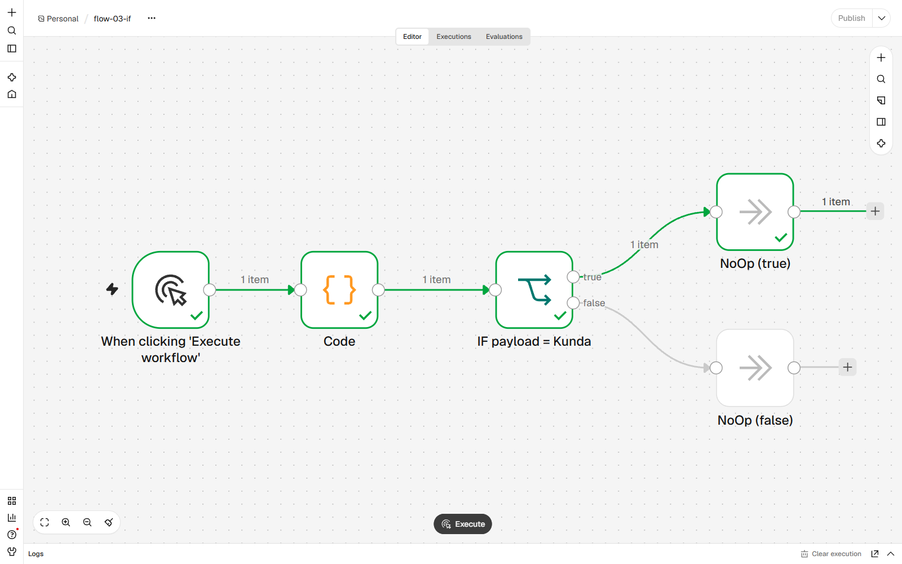

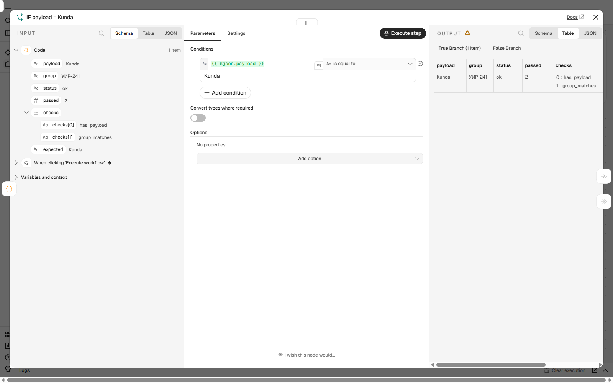

### 4.4. Manual Trigger → Set → Code (полный объект сообщения)

`flow-04-set.json`

* **Set message**: `topic = "lab4/kunda/set"`,
  `timestamp = {{ $now.toISO() }}`, `payload = "Kunda"`.
* **Code**: выводит полный объект сообщения и список его полей.


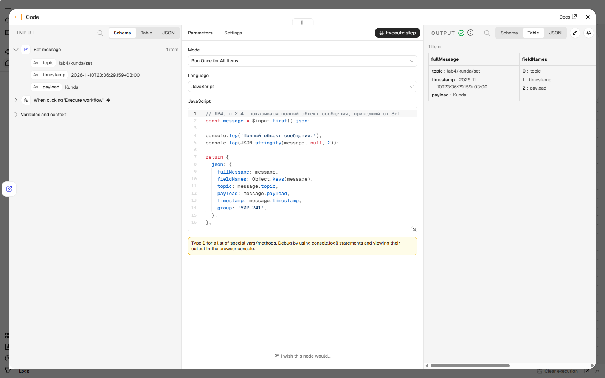

Результат: `fullMessage = {topic, timestamp, payload}`,
`fieldNames = [topic, timestamp, payload]`,
`timestamp = 2026-11-10T23:36:29.159+03:00`.

### 4.5. Manual Trigger → HTTP Request → Code

`flow-05-http.json`

**Важно:** указанный в методичке адрес `https://catfacts.ninja/fact` не
существует (домен не резолвится). Использован рабочий публичный API
**`https://catfact.ninja/fact`** (без «s»), отдающий JSON вида
`{"fact": "...", "length": N}`.

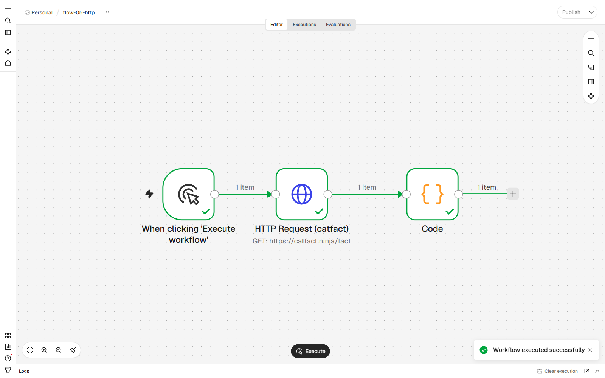

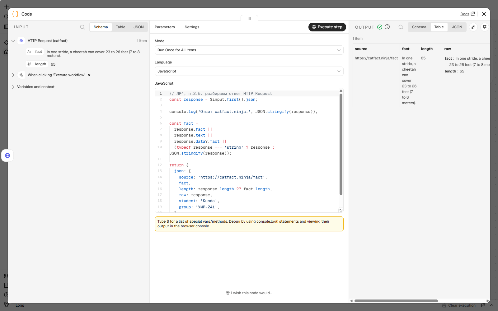

Фактический ответ в момент выполнения:
`"In one stride, a cheetah can cover 23 to 26 feet (7 to 8 meters)."` (`length = 65`).

### 4.6. Schedule Trigger → Code

`flow-06-schedule.json`

* **Schedule Trigger**: cron `*/5 * * * *` (каждые 5 минут).
* **Code**: возвращает текущее время (`currentTime`, `localTime`, `timezone`,
  `unix`) и метку группы.

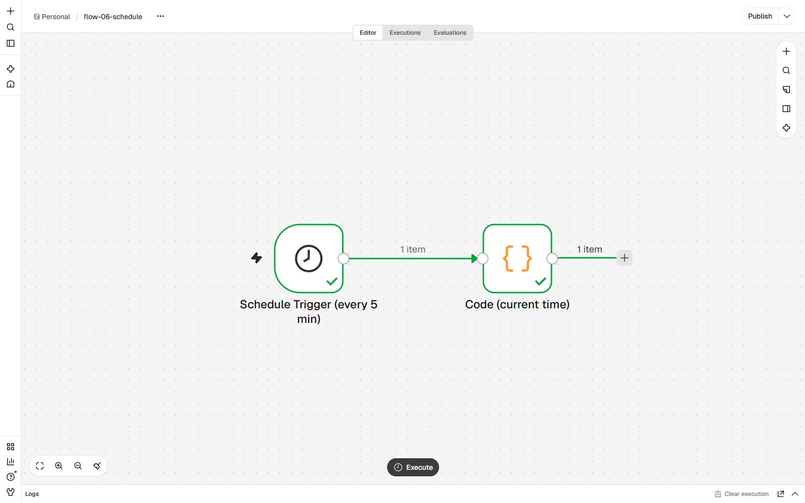

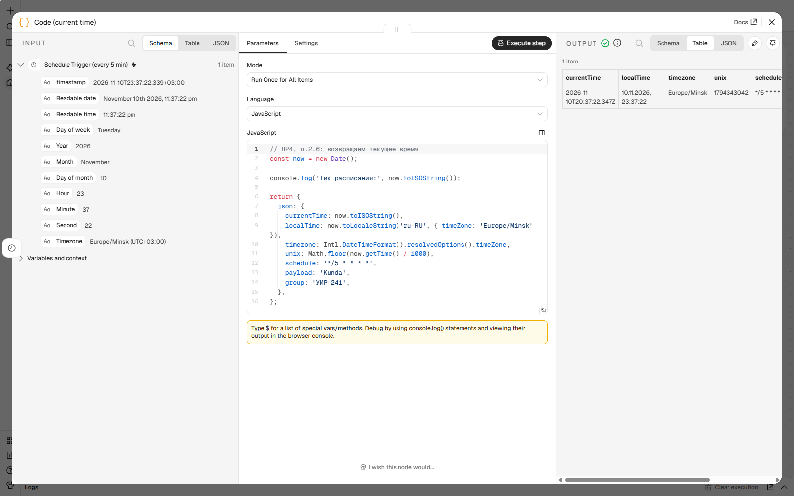

Результат: `currentTime = 2026-11-10T20:37:22.347Z`,
`localTime = 10.11.2026, 23:37:22`, `timezone = Europe/Minsk`,
`schedule = */5 * * * *`.

### 4.7. Redis: запись и чтение

`flow-09-redis.json` — Manual Trigger → Redis (Set) → Redis (Get),
ключ `kunda`.

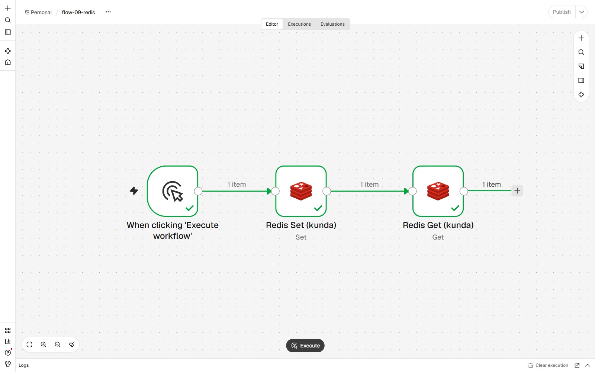

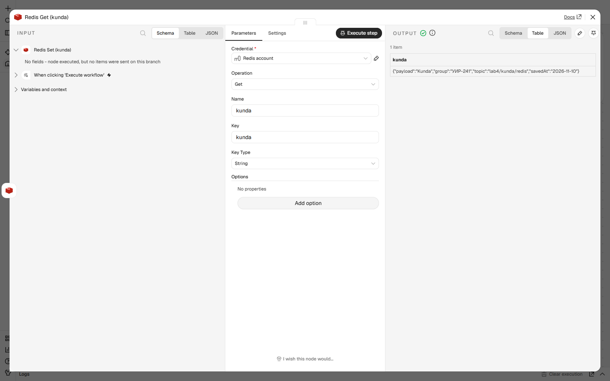

### 4.8. Redis: удаление и проверка

`flow-10-redis.json` — Manual Trigger → Redis (Delete) → Redis (Keys) → Code.

Операции `EXISTS` в узле Redis нет, поэтому факт удаления проверяется через
`KEYS` + `Code` (`exists = false`, `keysFound = []`).

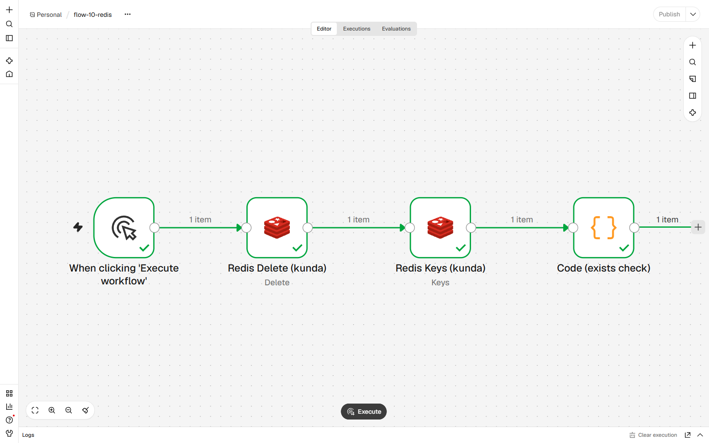

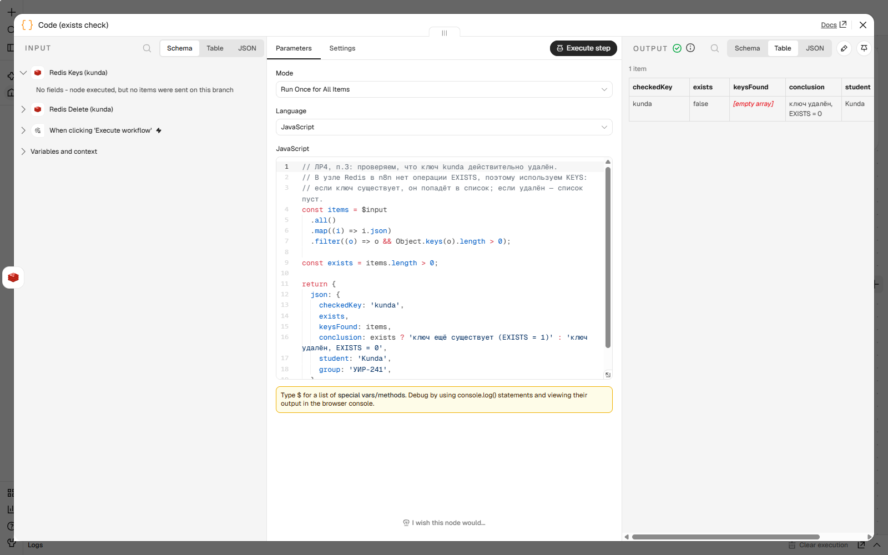

Подробное описание работы с Redis — в [redis.md](redis.md).

## 5. Освоенные узлы

| Узел | Назначение | Где использован |
|------|------------|-----------------|
| Manual Trigger | ручной запуск сценария | flow-01…05, 09, 10 |
| Schedule Trigger | запуск по cron | flow-06 |
| Set | формирование полей сообщения | flow-01, flow-04 |
| Code | произвольный JS, работа с `$input`/`$json` | все сценарии |
| IF | ветвление по условию | flow-03 |
| NoOp | «пустой» узел-заглушка, точка слияния | flow-02, flow-03 |
| HTTP Request | GET-запрос к внешнему API, JSON-ответ | flow-05 |
| Redis | Set / Get / Delete / Keys | flow-09, flow-10 |

Дополнительно освоено: создание Credentials (Redis), просмотр входа/выхода
узла в панели NDV, журнал выполнений, экспорт и импорт воркфлоу.

## 6. Примеры ключевых AI-промптов

Работа выполнялась агентом, поэтому промпты приведены в том виде, в каком они
задавали действия:

1. **Диагностика окружения**
   > «Проверь, что установлено: docker, wsl, git, gh, node, playwright. Не
   > притворяйся, что выполнил действие, если оно требует человека.»

2. **Запуск сервисов**
   > «Запусти n8n на порту 5678 с volume для данных и Redis на 6379. Если
   > Docker недоступен — предложи эквивалентный способ и опиши отклонение в
   > отчёте.»

3. **Генерация воркфлоу**
   > «Создай workflow: Manual Trigger → Set → Code. В Set: payload = "Kunda",
   > topic = "lab4/kunda/basic". В Code верни объект с полем payload.
   > Экспортируй в JSON.»

4. **Работа с Redis**
   > «Создай два workflow: Set→Get и Delete→Exists, ключ = фамилия. Если
   > операции EXISTS нет — предложи корректную замену и объясни её в
   > документации.»

5. **Скриншоты**
   > «Сделай скриншот работающего workflow: общий вид после выполнения и
   > панель последнего узла с результатом. Сохрани в lab4/screenshots/ как
   > NN-имя.png.»

## 7. Проблемы и их решения

| Проблема | Решение |
|----------|---------|
| Docker не установлен, нет прав администратора и WSL2 | запуск n8n через npm, Redis — портативной сборкой; отклонение описано в п.3 |
| `n8n-nodes-base` не найден при первом старте | `npm install` ещё не завершился; после завершения установки n8n стартовал нормально |
| Redis не принимал `--save ""` в PowerShell | использован `--save 900 1` |
| Домен `catfacts.ninja` из методички не существует | заменён на рабочий `catfact.ninja`, зафиксировано в п.4.5 |
| У узла Redis нет операции `EXISTS` | проверка через `KEYS` + `Code`, подтверждена `redis-cli` |
| `n8n export:workflow` выгружал устаревший снимок версии | итоговые JSON синхронизированы с фактически исполнявшимся состоянием из базы n8n |
| Кириллица побилась при правке файла через PowerShell | файлы перезаписаны в UTF-8 без BOM, добавлена проверка `json.load` для всех файлов |

## 8. Выводы

В ходе работы я собрал в n8n восемь сценариев: от простейшей цепочки
«триггер → данные → код» до ветвления, обращения к внешнему API, запуска по
расписанию и работы с внешним хранилищем Redis.

Главное, что стало понятно: n8n удобен там, где логика укладывается в
несколько узлов, а вся «настоящая» обработка всё равно уезжает в узел `Code`.
Узел `Set` хорош для явного описания структуры сообщения, `IF` — для
разделения потоков, но как только появляется нетривиальная логика, JSON
выражения становятся менее читаемыми, чем обычный JavaScript.

Отдельный вывод — про инфраструктуру. Лабораторная задумана на Docker, но
работать пришлось на машине без него. Оказалось, что n8n и Redis прекрасно
запускаются нативно, и на уровне сценариев это ничего не меняет: важен
протокол и порт, а не способ упаковки. При этом пришлось аккуратно разбираться
с деталями: где n8n хранит данные, почему SQLite нельзя держать в
синхронизируемой папке, почему экспорт может отдать не то состояние, которое
только что исполнялось.

Ещё один практический момент — расхождения в методичке. Мёртвый домен
`catfacts.ninja` и отсутствующая операция `EXISTS` в узле Redis — ровно те
случаи, когда нужно не «подогнать» результат, а найти рабочую замену и честно
описать её. В работе это сделано: вместо `EXISTS` используется `KEYS` с
последующей проверкой в `Code`, а факт удаления ключа дополнительно подтверждён
командой `redis-cli exists kunda` → `0`.

## 9. Структура работы

```
visual-programming-labs-kunda/
├── README.md
├── docker-compose.yml          # эквивалентная Docker-конфигурация
├── scripts/
│   ├── start-n8n.ps1
│   └── start-redis.ps1
└── lab4/
    ├── docs/
    │   ├── report.md           # этот файл
    │   └── redis.md
    ├── flows/
    │   ├── flow-01-manual-set.json
    │   ├── flow-02-code.json
    │   ├── flow-03-if.json
    │   ├── flow-04-set.json
    │   ├── flow-05-http.json
    │   ├── flow-06-schedule.json
    │   ├── flow-09-redis.json
    │   └── flow-10-redis.json
    └── screenshots/
        ├── 00-workflows-list.png
        ├── 01-version.png
        ├── 02-manual-set.png / 02-manual-set-result.png
        ├── 03-code.png / 03-code-result.png
        ├── 04-if.png / 04-if-result.png
        ├── 05-set.png / 05-set-result.png
        ├── 06-http.png / 06-http-result.png
        ├── 07-schedule.png / 07-schedule-result.png
        ├── 08-redis-set-get.png / 08-redis-set-get-result.png
        └── 09-redis-delete-exists.png / 09-redis-delete-exists-result.png
```

Нумерация `flow-*` соответствует пунктам методички; файлов `flow-07` и
`flow-08` в задании нет, поэтому нумерация Redis-сценариев начинается с `09`.
