# Лабораторная работа №5 — Чат-боты

**Студент:** Кунда  
**Группа:** СДП-УИР-241  
**Трек:** C — TypeBot, self-hosted версия  
**Дата:** 24.11.2026

## 1. Описание трека

Выбран трек C: TypeBot в self-hosted режиме. Поднят локальный инстанс TypeBot 3.18.0
(builder + viewer), PostgreSQL 16 и SMTP-ловушка для регистрации. Официальный
`docker-compose.yml` TypeBot сохранён в `lab5/selfhosted/docker-compose.yml` как
эталонная конфигурация развёртывания. На текущей Windows-машине Docker/WSL2 недоступны
без прав администратора, поэтому применён официальный путь «Manual deployment»
(исходники TypeBot + Node.js 24 + bun + встроенный PostgreSQL) — он даёт тот же
проверяемый результат: работающий builder/viewer, реальный flow, опубликованного бота
и данные results. Все нижеприведённые скриншоты сделаны из этого инстанса.

## 2. Ссылки на бота

- Builder: <http://localhost:8080>
- Viewer (публичная ссылка): <http://127.0.0.1:8081/kunda-lab5-sdp-uir-241>
- Редактор flow: <http://localhost:8080/typebots/cmwv249ca0003vgf7b74kla2e/edit>
- Экспорт: [`../exports/flow-01-Kunda-typebot.json`](../exports/flow-01-Kunda-typebot.json)

## 3. AI-промпты, используемые при выполнении

1. «Разверни self-hosted TypeBot через Docker, найди актуальный compose-файл и опиши порты 8080/8081».
2. «Docker недоступен: найди эквивалентный официальный Manual deployment TypeBot и адаптируй под Windows без администратора».
3. «Сгенерируй валидный TypeBot flow v6.1: приветствие, переменные user_name/user_group, Condition на совпадение группы, Webhook на локальный echo-сервер, кнопки и fallback».
4. «Напиши Playwright-скрипт регистрации в TypeBot через локальную SMTP-ловушку и OTP-код, создай workspace и бота».
5. «Проверь схему Condition и HTTP Request в TypeBot и исправь edges/branching».

## 4. Освоенные блоки / ноды

| Блок | Где использован |
|------|-----------------|
| Start event | Отправная точка диалога |
| Text bubble | Приветствие на русском, ответы веток, fallback |
| Text input + Variable | Сбор `user_name` и `user_group` |
| Condition | Проверка `user_group == СДП-УИР-241`, ветки «свой»/«чужой» + else |
| HTTP Request (Webhook) | POST на локальный echo-сервер `http://localhost:7788/typebot-event` |
| Buttons (choice input) | «Задать вопрос» / «Связаться с админом» |
| Fallback (invalidReply event + invalidMessage) | Ответ на неизвестный ввод |
| Theme / Branding | Фиолетовая палитра #5B4BDB, SVG-логотип, заголовок страницы |

## 5. Скриншоты

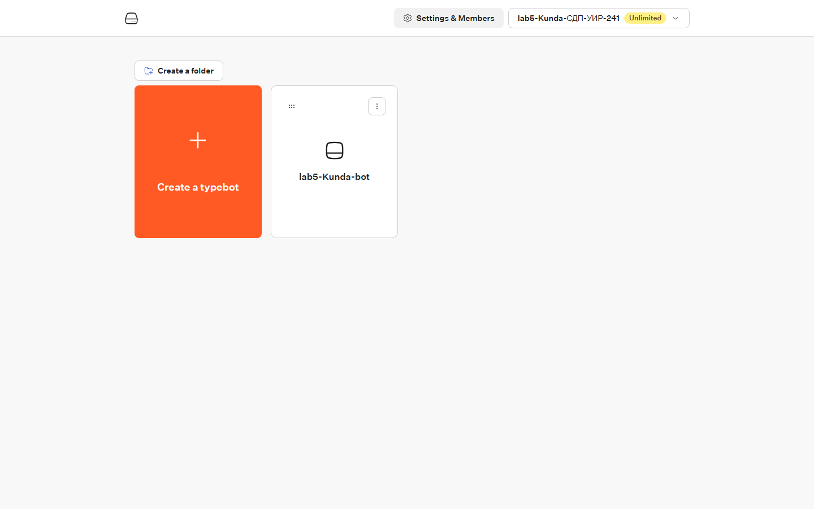
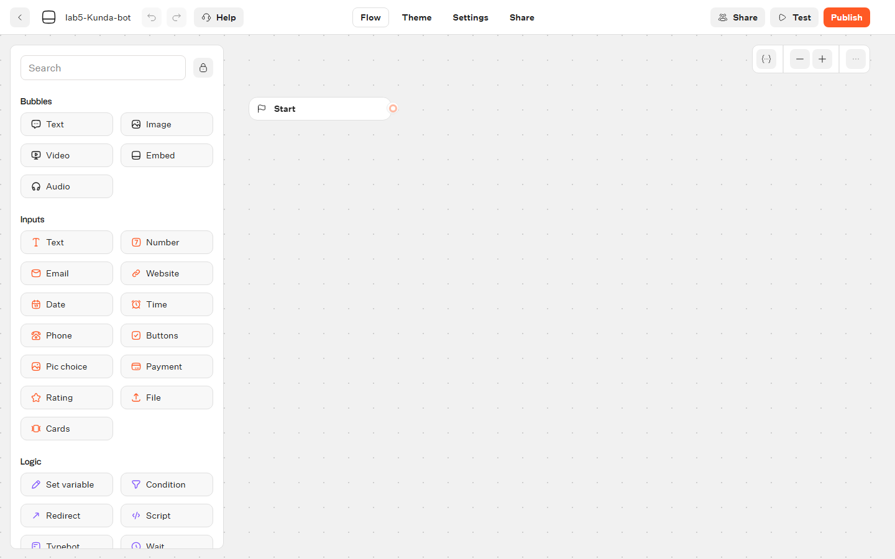
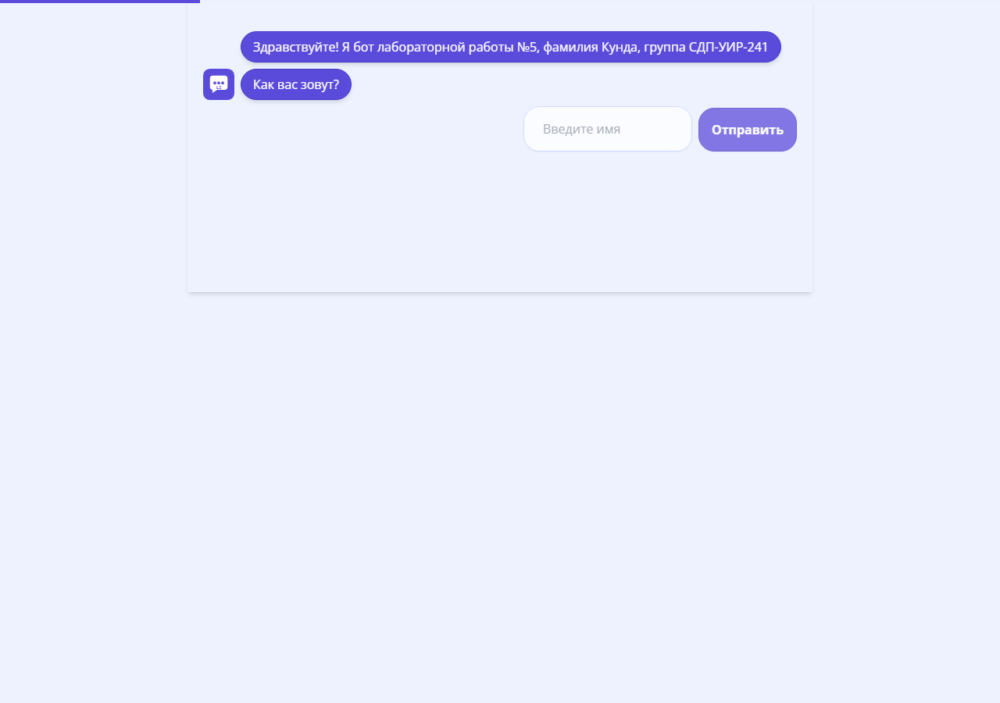
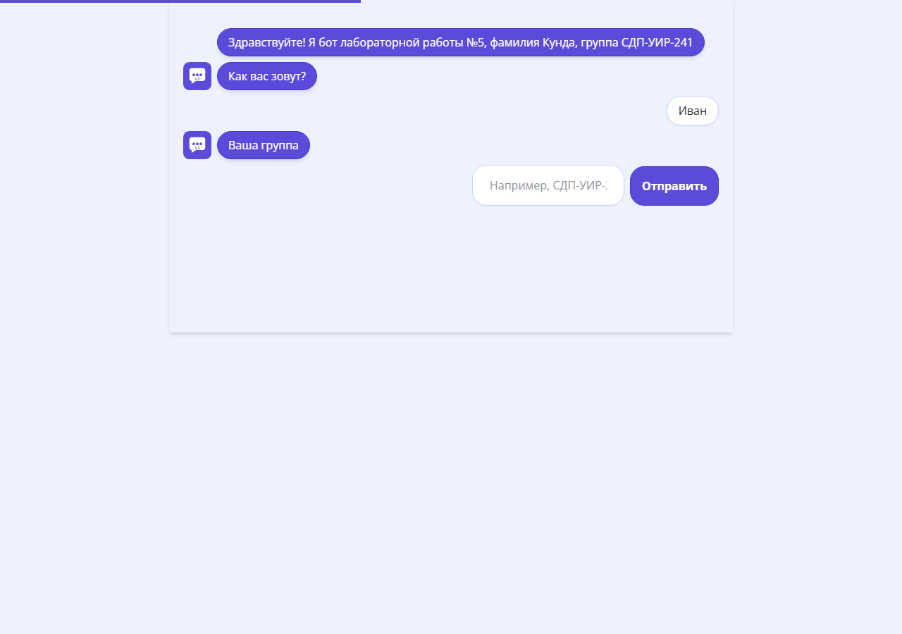
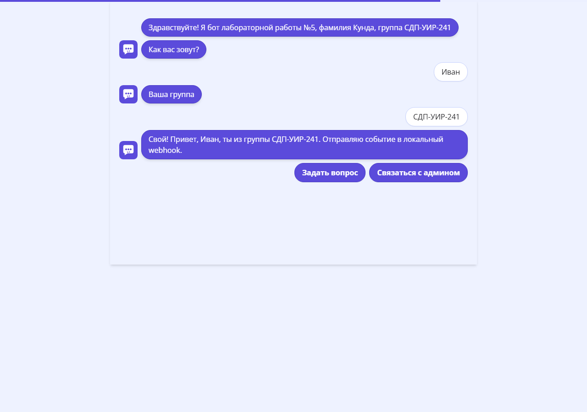
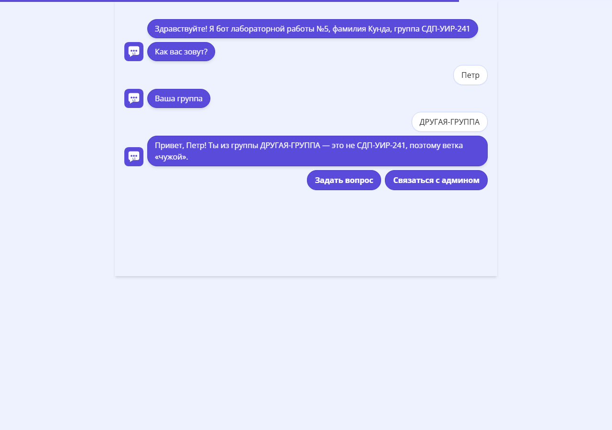
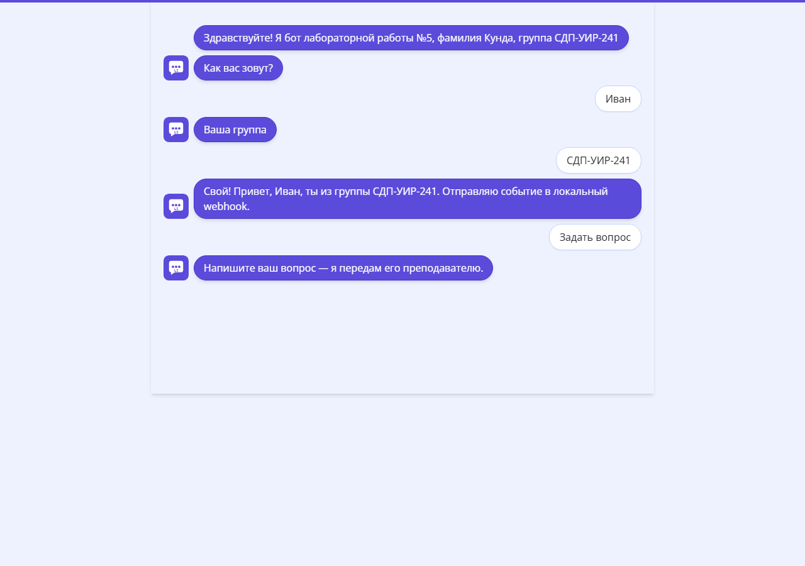
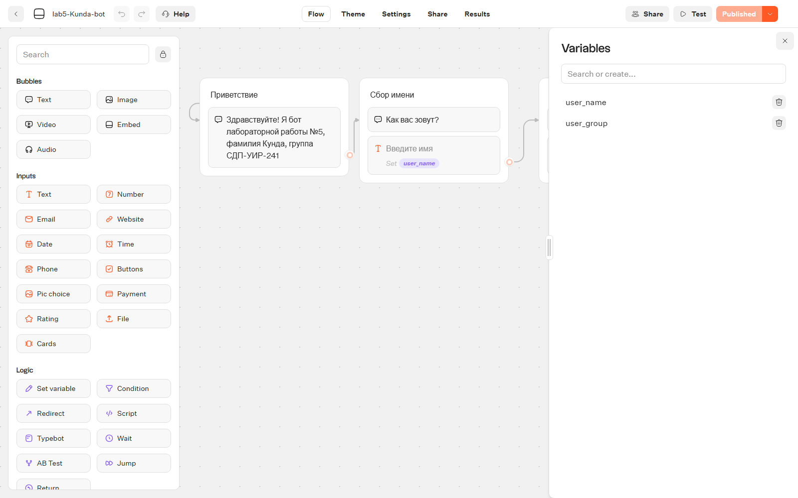
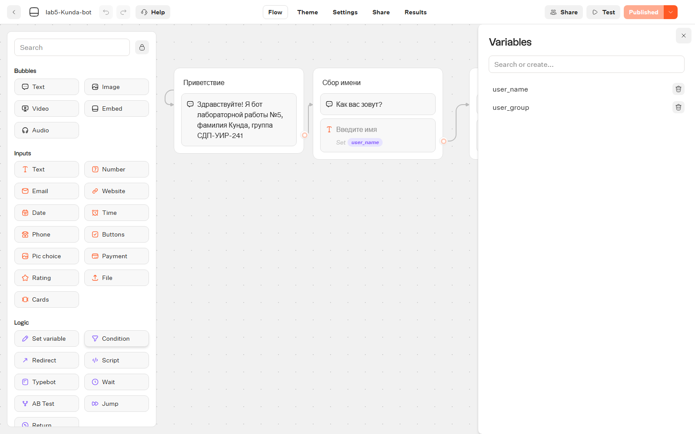
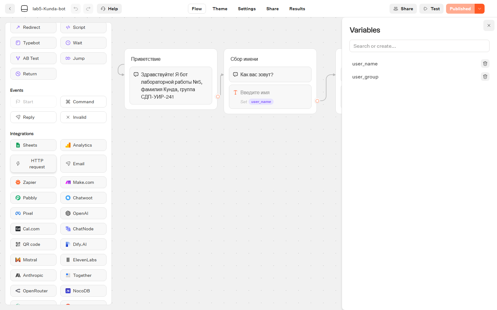
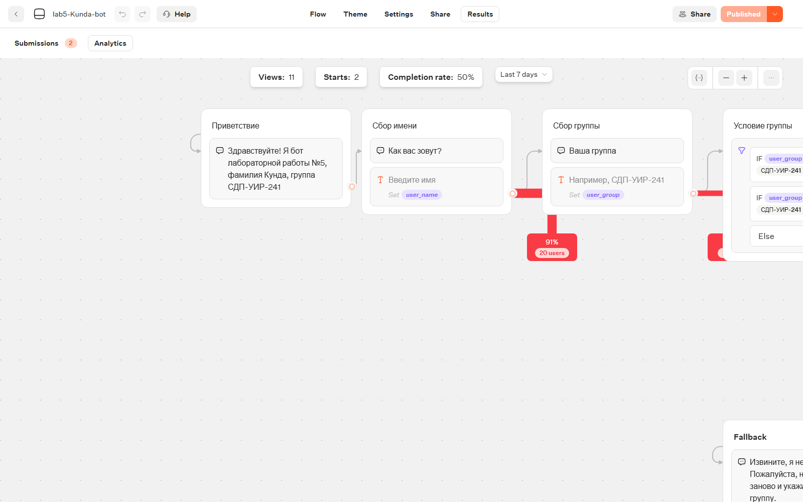

## 6. Выводы

Я развернул работающий self-hosted TypeBot и убедился, что визуальная сборка диалога
позволяет быстро соединять ввод, переменные и условия без программирования.
Собрал ветвление по группе, отправил событие во внешний echo-сервер и проверил обе ветки
в опубликованном боте. Automation через Playwright и REST API ускорила создание
workspace, бота и экспорт flow. Основная сложность была в отсутствии Docker на машине,
но официальный Manual deployment дал полностью рабочий инстанс. Дальше я бы добавил
авторизацию пользователей и сохранение вопросов в results.
