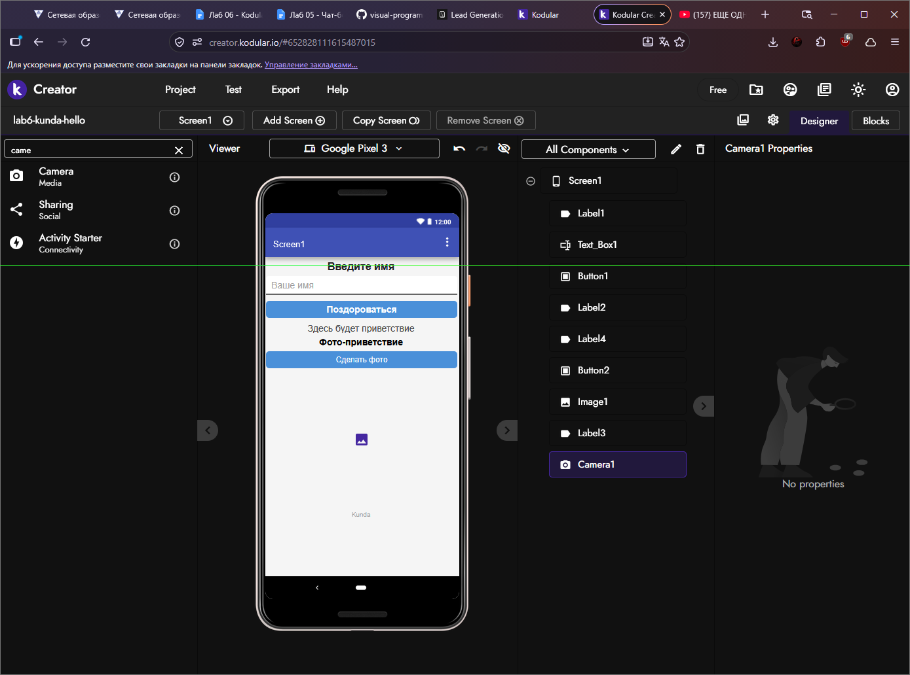
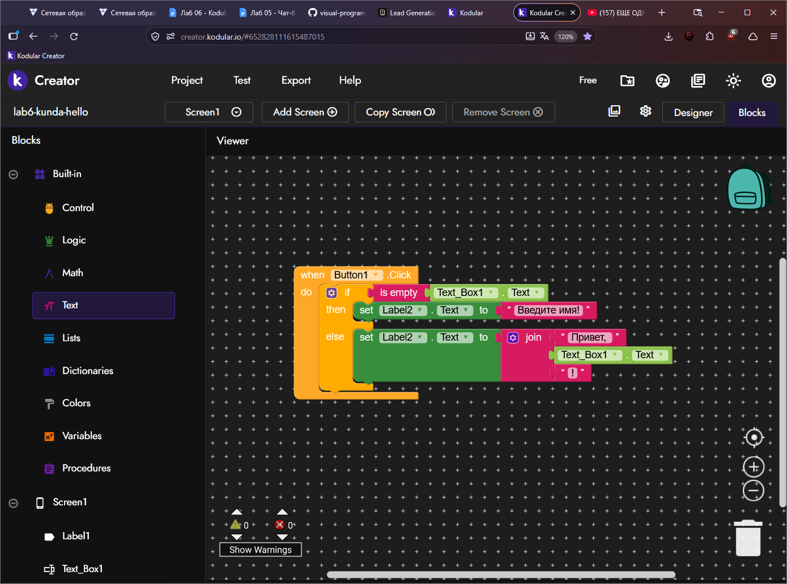
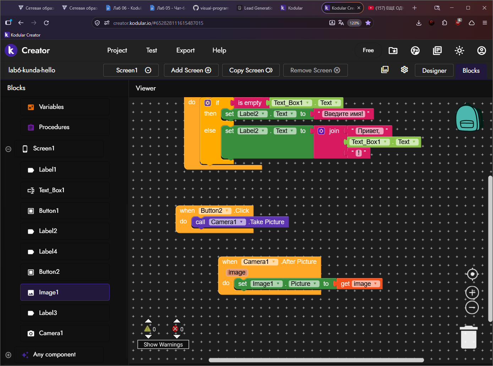
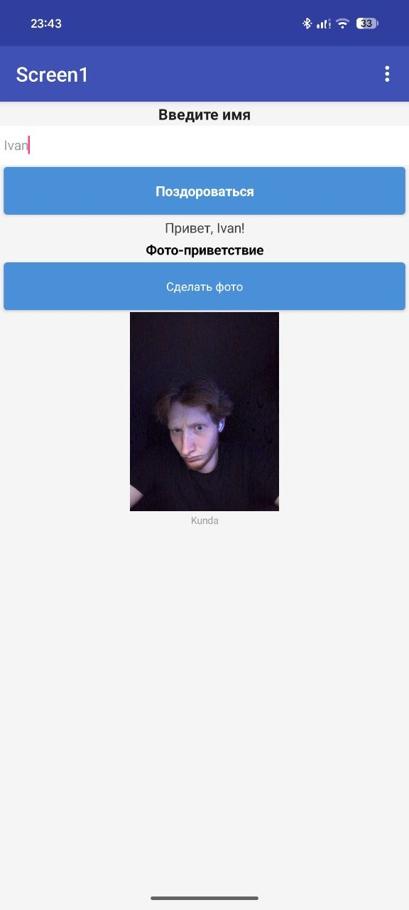

# Лабораторная работа №6 — Kodular

**Студент:** Кунда Иван  
**Группа:** СДП-УИР-241  
**Дата:** 24.11.2026

## 1. Описание приложения

В Kodular создано приложение «Приветствие» (`Smth`, пакет `io.kodular.kakaha710.Smth`).
На экране `Screen1` пользователь вводит имя, нажимает кнопку «Поздороваться» —
программа проверяет, пусто ли поле, и выводит либо «Введите имя!», либо «Привет, <имя>!».
Внизу экрана размещён Label с фамилией **Kunda** на английском языке — это
обязательное требование задания, подтверждающее авторство работы.

Дополнительно реализована одна ачивка — **Ачивка 13: Камера**: кнопка «Сделать фото»
запускает камеру, после съёмки сделанный снимок отображается в компоненте `Image`.
Это «фото-приветствие» из списка дополнительных заданий.

Исходный проект экспортирован в [`../exports/lab6-kunda.aia`](../exports/lab6-kunda.aia).
Проект в Kodular Gallery не публиковался — сдача идёт через файл `.aia`.

## 2. Компоненты и блоки

### Компоненты `Screen1`

| Компонент | Назначение |
|-----------|------------|
| `Label1` | Заголовок «Введите имя» |
| `Text_Box1` | Поле ввода имени, `Hint = Ваше имя` |
| `Button1` | Кнопка «Поздороваться» |
| `Label2` | Вывод результата (изначально «Здесь будет приветствие») |
| `Label4` | Заголовок блока камеры «Фото-приветствие» |
| `Button2` | Кнопка «Сделать фото» |
| `Image1` | Показ сделанного снимка (`Height = 200`, `ScalePictureToFit`) |
| `Label3` | Фамилия `Kunda` на английском языке |
| `Camera1` | Компонент камеры для съёмки |

### Блоки базовой логики

- `Button1.Click` → `controls_if` с веткой `else`;
- условие: `text_isEmpty(Text_Box1.Text)`;
- если пусто → `set Label2.Text to "Введите имя!"`;
- иначе → `set Label2.Text to text_join("Привет, ", Text_Box1.Text, "!")`.

Основные освоенные блоки: `component_event`, `controls_if`, `text_isEmpty`,
`text_join`, `component_set_get`, `text`, `component_method`, `lexical_variable_get`.

### Ачивка 13: Камера

- `Button2.Click` → `call Camera1.TakePicture`;
- `Camera1.AfterPicture` → `set Image1.Picture to image` (параметр события `image`).

Таким образом снимок, сделанный камерой, сразу появляется в `Image1` без сохранения
в галерею — минимальная рабочая схема «снял → показал».

## 3. AI-промпты, использованные при выполнении

1. «Как в Kodular сделать так, чтобы при нажатии на кнопку проверялось, пустое ли текстовое поле, и выводилось сообщение?»
2. «Какие блоки нужны, чтобы соединить текст «Привет, », введённое имя и восклицательный знак? Пример с text_join».
3. «Как в Kodular вызвать камеру по кнопке и показать получившееся фото в Image? Опиши блоки TakePicture и AfterPicture».
4. «Проверь экспортированный .aia: есть ли на первом экране фамилия на английском и работает ли логика if/else для приветствия».
5. «Оформи отчёт по лабораторной №6: опиши компоненты, блоки, ачивку «Камера» и ограничения бесплатного тарифа».

## 4. Скриншоты

| Файл | Что подтверждает |
|------|------------------|
|  | Экран с видимой фамилией `Kunda`, полем ввода, кнопками и `Image` |
|  | Условный блок `if/else`, `text_isEmpty` и `text_join` |
|  | `Camera1.TakePicture` и `Camera1.AfterPicture` → `Image1.Picture` |
|  | Работа приложения в Kodular Companion |

## 5. Ограничения бесплатного тарифа Kodular

В работе использован бесплатный тариф: до 10 проектов, до 10 МБ ассетов и до 5 расширений
(extensions). Данное приложение укладывается в лимиты: используется один проект,
встроенные компоненты без внешних ассетов и без установки extensions. Публикация
ссылки в Kodular Gallery не потребовалась — проект сдан файлом `.aia`.

## 6. Выводы

Я освоил базовый цикл разработки в Kodular: перетаскивание компонентов на экран,
настройка свойств (Hint, Text, размер `Image`), сборка логики из визуальных блоков
и экспорт проекта в `.aia`. Базовое задание продемонстрировало работу условия
`if/else` и соединения строк через `text_join`. Дополнительная ачивка «Камера»
показала, как события компонента (`AfterPicture`) связаны с обновлением интерфейса
через свойства (`Image.Picture`). Работа в Kodular Companion подтвердила, что
приложение запускается и реагирует на действия пользователя. В дальнейшем можно
добавить сохранение имени между запусками через TinyDB или историю приветствий
через Firebase.
